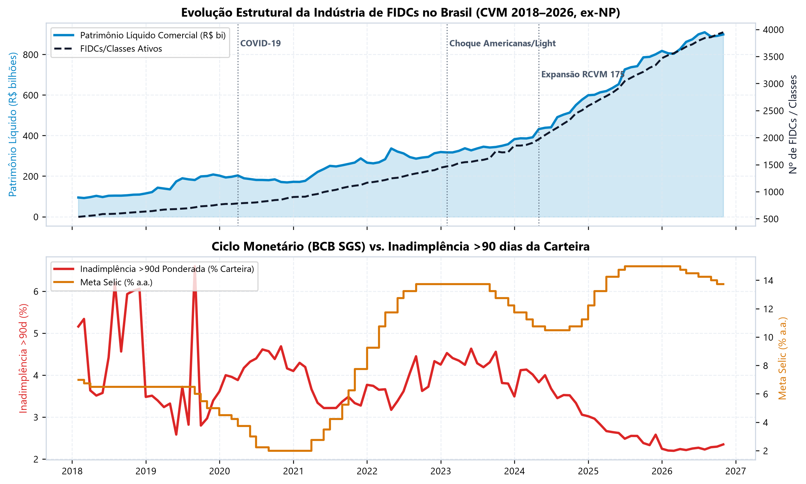
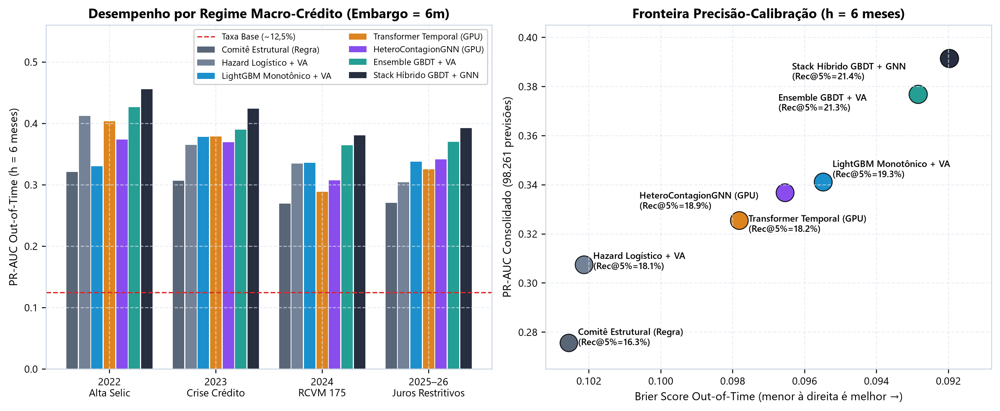
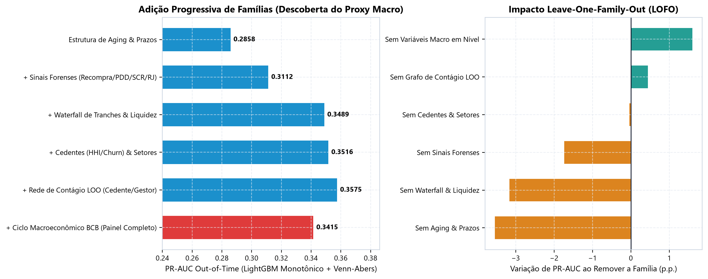
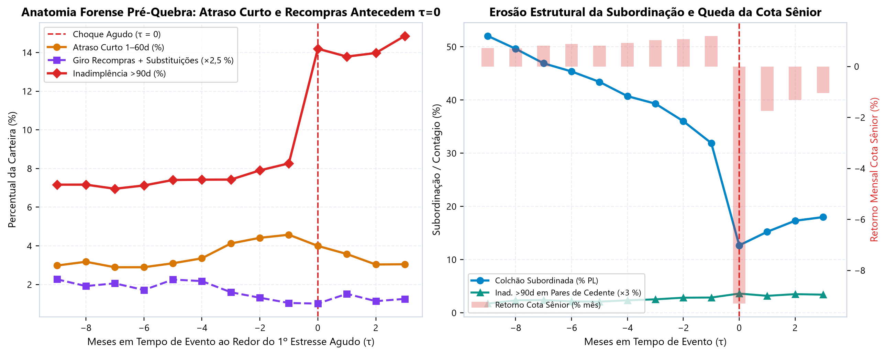
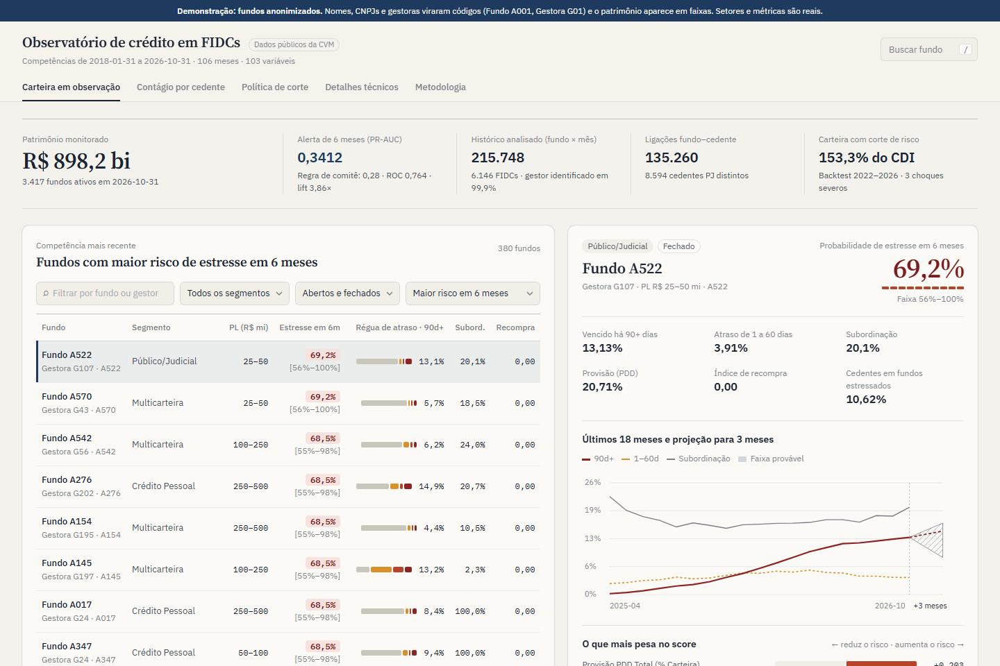

# fidc-risk-br

**Alerta precoce de estresse de crédito, contágio em grafos corporativos e alocação sob incerteza para os 6.146 Fundos de Investimento em Direitos Creditórios (FIDCs) brasileiros** (`2018–2026`), com Lakehouse Medallion em DuckDB/Parquet, calibração multiprobabilística de Venn-Abers, regressão quantílica conformal (CQR) e redes espaço-temporais treinadas em GPU.

Especificação matemática, invariantes contábeis e regras anti-vazamento em [SPEC.md](SPEC.md).

**Demo ao vivo (fundos anonimizados):** https://pedrohbenetton.github.io/fidc-risk-br/

[](https://github.com/pedrohbenetton/fidc-risk-br/actions/workflows/ci.yml)
[](LICENSE)
[](.python-version)
[](src/fidc_risk/lakehouse/)
[](src/fidc_risk/models/deep_contagion.py)

---

## Resumo Executivo

Os FIDCs financiam mais de **R\$ 850 bilhões** em recebíveis comerciais, crédito pessoal de fintechs, cartões, consignado e agronegócio no Brasil. Na análise tradicional de crédito privado, fundos com inadimplência aparente acima de 90 dias baixa e colchão de subordinação positivo parecem seguros — até que mecanismos contábeis e de rede provoquem quebras abruptas. Este projeto constrói uma plataforma completa sobre **106 competências mensais oficiais da CVM e do Banco Central (`2018-01` a `2026-10`, 215.748 observações fundo-mês e 135.260 arestas de cedentes)**:

1. **Engenharia de Dados & Reconciliação RCVM 175**: Harmonização das 18 tabelas mensais do `INF_MENSAL_FIDC` entre três gerações de schema (`ICVM 356 → RCVM 175`) sem viés de sobrevivência (`99,99%` de aderência à identidade contábil das faixas de aging). Corrigir a inferência silenciosa de `float64` em CNPJs sem pontuação preservou zeros à esquerda, elevando a cobertura de gestores de **23,8% para 99,9%** e multiplicando por **3,9×** as arestas válidas de cedentes ([relatório da fase 1 & 2](reports/fase1_lakehouse_eda.md)).
2. **Alerta Precoce Honesto (Embargo = 6 meses)**: Em 98.261 previsões *walk-forward* sobre fundos comerciais saudáveis na largada, o **Stack Híbrido (`Ensemble GBDT + HeteroContagionGNN em GPU`)** eleva o PR-AUC de **0,2757** (regra estrutural de comitê) para **0,3915** (`+11,58 p.p.`, $p < 0,0001$) com erro de calibração **ECE = 0,66%** via Venn-Abers Indutivo.
3. **Quando o Grafo Ajuda (e Quando Não Ajuda)**: Medida com **5 sementes independentes em GPU** em cada janela temporal, a passagem de mensagens *Leave-One-Out* sobre cedentes corporativos compartilhados (`HeteroContagionGNN`) perde para o mesmo Transformer sem grafo nos anos pré-RCVM 175 de rede esparsa (`2022–2023`), mas **vira o jogo a partir de 2024** com a densificação da indústria (`+1,87 p.p.` em 2024 e `+1,65 p.p.` em 2025–26; ganho consolidado de `+1,11 p.p.`, $p = 0,0025$) ([relatório da fase 5](reports/fase5_deep_contagion_gpu.md)).
4. **O Que Não Funcionou — Proxy Macroeconômico em Árvores**: Na ablação das 6 famílias de features, todas as famílias microeconômicas e de rede melhoram o PR-AUC fora da amostra (`0,2858 → 0,3575`), mas incluir séries macroeconômicas agregadas em nível (`Selic`, `IBC-Br`, `Inadimplência SFN`) **reduz o PR-AUC em -1,60 p.p.** por atuarem como identificadores espúrios de data calendário em divisões de árvore ([relatório da fase 3](reports/fase3_tabular_calibracao.md)).
5. **Evidência Forense & Alocação c/ Prazo Real de Resgate**: Em fundos com inadimplência aparente `< 3%`, alto giro de recompras multiplica o risco futuro em **1,38×** ($p = 8 \times 10^{-17}$), déficit de PDD frente à Resolução BCB 2.682 multiplica em **1,79×** ($p = 3 \times 10^{-40}$) e contágio em cedentes compartilhados multiplica em **1,49×** ($p = 8 \times 10^{-16}$). No backtest de cotas sênior abertas (`2022–2026`, respeitando defasagem contratual $t+2$), as políticas guiadas pelo modelo superam o filtro tradicional em retorno relativo ao CDI e reduzem em até **62,5%** os choques severos sofridos pelo *yield-chasing* ([relatório da fase 6 & 7](reports/fase6_forense_alocacao.md)).



---

## Resultados Comparativos Out-of-Time

### 1. Alerta Precoce de Entrada em Estresse Severo ($h = 6$ meses, $n = 98.261$, Embargo = 6m)

Todos os números abaixo são extraídos diretamente dos CSVs e JSONs auditáveis em [`reports/metrics/`](reports/metrics/):

| Modelo / Arquitetura | PR-AUC | ROC-AUC | Brier Score | Log-Loss | ECE | Recall @ Top-5% | Lift @ Top-5% |
|---|---:|---:|---:|---:|---:|---:|---:|
| Comitê Estrutural (Regra Heurística) | 0,2757 | 0,6892 | 0,1026 | 0,3529 | 0,0209 | 16,3% | 3,25× |
| Hazard Logístico Regularizado + Venn-Abers | 0,3076 | 0,7269 | 0,1021 | 0,3447 | 0,0365 | 18,1% | 3,63× |
| Transformer Temporal Causal s/ Grafo (GPU, 5 seeds) | 0,3256 | 0,7393 | 0,0978 | 0,3343 | 0,0234 | 18,2% | 3,64× |
| **HeteroContagionGNN LOO (GPU, 5 seeds)** | 0,3369 | 0,7505 | 0,0965 | 0,3284 | 0,0168 | 18,9% | 3,79× |
| LightGBM Irrestrito (Bruto, Sem Calibração) | 0,3401 | 0,7644 | 0,1014 | 0,3519 | 0,0724 | 19,1% | 3,82× |
| LightGBM Monotônico + Venn-Abers (Servido na API) | 0,3412 | 0,7645 | 0,0955 | 0,3239 | 0,0095 | 19,3% | 3,86× |
| LightGBM Irrestrito + Venn-Abers | 0,3475 | 0,7684 | 0,0950 | 0,3216 | 0,0070 | 19,8% | 3,96× |
| CatBoost Ordenado + Venn-Abers | 0,3773 | 0,7858 | 0,0930 | 0,3142 | 0,0128 | 21,3% | 4,26× |
| Ensemble Tabular (`LightGBM + CatBoost`) + VA | 0,3769 | 0,7866 | 0,0928 | 0,3137 | 0,0079 | 21,3% | 4,26× |
| **Stack Híbrido (`Ensemble GBDT + GPU Contagion GNN`)** | **0,3915** | **0,7914** | **0,0920** | **0,3104** | **0,0066** | **21,4%** | **4,28×** |

*(No horizonte curto $h = 3$ meses, com taxa base de `7,10%`, o Ensemble atinge `ROC-AUC = 0,8131`, `ECE = 0,0047` e captura **28,7%** de todas as crises inspecionando apenas os **5%** mais arriscados da indústria — **Lift de 5,74×**).*



### 2. Previsão Probabilística da Inadimplência $>90$ dias (Roll-Rate Markov vs. LightGBM + CQR)

| Modelo | WIS $h=1\text{m}$ (p.p.) | WIS $h=3\text{m}$ (p.p.) | WIS $h=6\text{m}$ (p.p.) | Cob. 90% ($h=3\text{m}$) |
|---|---:|---:|---:|---:|
| Persistência Global | 0,813 | 1,676 | 2,597 | 90,7% |
| Persistência Estratificada por Nível (Ref.) | 0,722 | 1,447 | 2,229 | 92,5% |
| Matriz de Roll-Rate de Markov (Empirical Bayes) | 0,771 | 1,668 | 2,737 | 91,0% |
| **LightGBM Quantílico + CQR Estratificado** | **0,616 (-14,7%)** | **1,198 (-17,2%)** | **1,981 (-11,1%)** | **94,9%** |



---

## Fases e Relatórios Técnicos

- [x] **Fase 1 & 2 — Lakehouse Medallion, RCVM 175 e Anti-Vazamento**: ingestão assíncrona CVM + BCB, correção de zeros à esquerda em CNPJs, invariantes contábeis e testes de perturbação adversarial do futuro ([relatório fase 1 & 2](reports/fase1_lakehouse_eda.md)).
- [x] **Fase 3 — Suíte Tabular, Venn-Abers e Ablação de Famílias**: comparação entre Platt, Isotônica e Venn-Abers Indutivo, restrições monotônicas e descoberta da degradação por proxy macroeconômico ([relatório fase 3](reports/fase3_tabular_calibracao.md)).
- [x] **Fase 4 — Roll-Rate de Markov 5×5 e Regressão Quantílica Conformal (CQR)**: estimação por `NNLS` com *Empirical Bayes* setorial e intervalos calibrados em $h \in \{1, 3, 6\}$ meses ([relatório fase 4](reports/fase4_rollrate_cqr.md)).
- [x] **Fase 5 — Transformer Temporal & HeteroContagionGNN em GPU (5 Sementes)**: passagem de mensagens bipartida *Leave-One-Out* (`FIDC ↔ Cedente ↔ Gestor`) em CUDA e stacking híbrido com GBDT ([relatório fase 5](reports/fase5_deep_contagion_gpu.md)).
- [x] **Fase 6 & 7 — Estudo Forense, Backtest de Portfólio c/ Lag, SHAP e Drift**: testes de recompras/SCR 2.682, alocação contra o CDI, explicabilidade TreeSHAP e PSI semestral ([relatório fase 6 & 7](reports/fase6_forense_alocacao.md)).
- [x] **Estudo de contágio por cedente (2022–2026)**: classes que passam a dividir um cedente com quem acabou de entrar em estresse entram mais em estresse em 6 meses na comparação simples (+6,2 p.p. contra controles do mesmo segmento e porte), mas quase tudo é atraso que elas já tinham: pareando também pelo nível e pelo histórico de vencido 90+, a diferença cai para +1,8 p.p. (IC −0,1 a +3,8). Sinal fraco, não robusto; fica fora do boletim ([relatório](reports/fase9_contagio_cedente.md), `uv run fidc-risk study-cedente-contagion`).
- [x] **Metodologia para analistas**: [`web/metodologia.html`](web/metodologia.html) e [PDF](web/metodologia.pdf) respondem "por que confiar no score?" sem jargão: dados e defasagem, definição do evento, validação fora da amostra por ano (ordenação, concentração no topo 5%, calibração por safra), onde o modelo erra e limitações. Regerar com `uv run fidc-risk export-methodology`.
- [x] **Fase 8 — Observatório Interativo Web (`web/`) & API FastAPI**: radar de fundos com *fan charts* CQR, grafo de contágio interativo, simulador de comitê e inferência contrafactual ao vivo (`/api/v1/score`).



---

## Camada Interativa (Web Estática + API FastAPI Contrafactual)

O diretório [`web/`](web/) funciona de duas formas:
1. **Estático e anonimizado (demo)**: lê [`web/data/observatory_bundle.json`](web/data/observatory_bundle.json), em que nome, CNPJ e gestor de cada fundo viraram códigos estáveis (Fundo A001, Gestora G01) e o patrimônio aparece em faixas. É o único pacote que vai a público; ver [Demo anonimizado](#demo-anonimizado-github-pages).
2. **Full-Stack com API FastAPI + DuckDB (uso local)**: ao subir `fidc-risk serve`, o observatório mostra os fundos identificados (pacote nominal em `data/private/`, fora do git) e os controles de **Teste de Estresse Contrafactual (What-If)** consultam `POST /api/v1/score` em tempo real (< 15 ms), recalculando probabilidades calibradas Venn-Abers, quantis CQR e atribuições TreeSHAP.



---

## Como Reproduzir do Zero

Requisitos: Python 3.12 e [`uv`](https://docs.astral.sh/uv/) (GPU NVIDIA opcional para `train-gnn`; fallback automático para CPU).

```bash
# 1. Instalar ambiente e dependências (testes automatizados + ruff + mypy)
uv sync --extra dev
uv run pytest -v

# 2. Executar o pipeline Medallion e modelagem ponta a ponta (~180 MB de dados oficiais CVM/BCB)
uv run fidc-risk ingest
uv run fidc-risk silver
uv run fidc-risk gold
uv run fidc-risk train-tabular
uv run fidc-risk train-rollrate
uv run fidc-risk train-gnn
uv run fidc-risk backtest-allocation
uv run fidc-risk export-web

# 3. Subir o Observatório Interativo + API Analítica FastAPI em http://127.0.0.1:8000
uv run fidc-risk serve --port 8000
```

### Boletim mensal agregado (`relatorio/`)

PDF de 2 páginas com indicadores da indústria inteira, sem identificar fundos. Um comando baixa da CVM o que
faltar (a competência, a anterior e a de 12 meses antes), calcula os indicadores e gera o PDF; a manchete e os
verbos dos destaques saem dos próprios números. Se a CVM ainda não publicou a competência, o comando falha com
uma mensagem clara e não gera nada.

```bash
uv run python -m relatorio.boletim 2026-10 --marca "Sua marca" --out-dir saida
# --atualizar baixa de novo a competência pedida (a CVM atualiza o arquivo com reenvios)
```

Os zips ficam em `data/bronze/` (os mesmos do pipeline) e os CSVs extraídos em `data/cvm_csv/`. Na página 2
entra o bloco do estudo de contágio por cedente (`relatorio/blocos/contagio_cedente.json`) quando ele existe.
Também dá para rodar as etapas separadas: `python -m relatorio.indicadores <dir_mes> <dir_anterior> <dir_12m> saida.json`
e `python -m relatorio.gerar_pdf "Sua marca" --indicadores saida.json`. Sem o ambiente completo,
`pip install -r requirements.txt` instala só o necessário para o boletim.

### Relatório da carteira de uma gestora (`relatorio/carteira.py`)

PDF de 2 a 3 páginas, privado para a gestora cliente, só com os fundos da carteira dela: resumo
(patrimônio somado, vencido 90+ ponderado pela carteira, fundos em estresse), uma linha por fundo
(score de estresse em 6 meses e faixa de incerteza, vencido 90+, PDD e variação no mês), cedentes que a
carteira divide com classes em estresse de fora dela (só a contagem dessas classes, nunca o nome) e o que
mudou desde o mês anterior. Vencido 90+, PDD e estresse seguem as definições do boletim (tabelas V+VI).

```bash
# CSV com uma coluna de CNPJs de classes de FIDC (com ou sem cabeçalho); CNPJ inválido interrompe com erro
uv run python -m relatorio.carteira --cnpjs exemplos/carteira_exemplo.csv --competencia 2026-10 --out relatorio.pdf
```

Os CSVs da CVM da competência e do mês anterior saem do zip baixado pelo pipeline (`data/bronze/`) e ficam
em cache em `data/cvm_csv/`; o score vem do painel Gold e do modelo servido (o mesmo do observatório).
`exemplos/carteira_exemplo.csv` tem 10 CNPJs reais sorteados; os PDFs gerados na raiz ficam fora do git.

### Demo anonimizado (GitHub Pages)

Material que vai para terceiros não pode mostrar nome ou CNPJ de um fundo ao lado do score. O build demo
troca nome, CNPJ e gestor por códigos estáveis (`Fundo A001`, `Gestora G01`, `Cedente C001`), põe o
patrimônio em faixas (`R$ 100–250 mi`) e remove o que devolveria o PL exato (PL mensal do histórico,
exposição em R$ por cedente, valor do log do PL entre os fatores do score). Setores e métricas continuam reais.
Um aviso "Demonstração: fundos anonimizados" fica fixo no topo.

```bash
# 1. Depois do pipeline: pacote nominal em data/private/ e público anonimizado em web/data/
uv run fidc-risk export-web
# 2. Site estático em dist/demo/ (falha e apaga o build se achar CNPJ ou nome real de fundo/gestor)
uv run fidc-risk export-demo            # --rebuild-bundle remonta o pacote a partir do Gold/Silver
# 3. Publicar: versione web/ e faça push na main; o workflow Pages roda `fidc-risk build-pages`
#    (confere que o pacote está anonimizado e sem CNPJ) e publica em GitHub Pages
git add web && git commit -m "chore(web): atualiza o observatório" && git push
```

Alternativa: `npx vercel deploy dist/demo --prod` publica o build local na Vercel.

- O mapeamento real → código fica em `data/private/demo_codes.json` (ignorado pelo git). É ele que mantém
  o mesmo código para o mesmo fundo entre execuções; guarde uma cópia, porque sem ele todos os códigos mudam.
- Na Vercel, o `vercel.json` do build pede aos buscadores para não indexar o demo; o GitHub Pages não aceita esse cabeçalho.
- `tests/test_demo_site.py` falha se algum CNPJ ou nome real de fundo ou gestor aparecer nos arquivos
  publicados (`web/` e `dist/demo/`). A checagem de nomes roda onde existe `data/private/`.
- Limite: é pseudonimização. As métricas são reais e podem ser cruzadas com os dados abertos da CVM por
  quem se dispuser a isso.

---

## Estrutura do Repositório

```text
├── SPEC.md                         # Especificação matemática, invariantes e regras anti-leakage
├── pyproject.toml                  # Configuração uv, PyTorch CUDA, ruff, pytest e mypy
├── src/fidc_risk/
│   ├── ingestion/                  # Cliente assíncrono resiliente CVM (HIST+DADOS+CAD) e BCB SGS
│   ├── lakehouse/                  # Harmonização Silver em DuckDB/Parquet e auditoria contábil
│   ├── features/                   # 103 features causais Gold, sinais forenses e grafo LOO
│   ├── models/                     # Calibração Venn-Abers, LightGBM/CatBoost, Markov/CQR e GNN GPU
│   ├── allocation/                 # Hipóteses forenses (Fisher) e backtest de cotas sênior c/ lag
│   ├── monitoring/                 # TreeSHAP global/local e monitoramento semestral de PSI/JS
│   ├── export/                     # Geração das 8 figuras científicas e bundle JSON verificado
│   └── api/                        # Serviço FastAPI (/health, /watchlist, /funds/{id}, /score)
├── reports/                        # Relatórios por fase, CSVs/JSONs auditáveis e figuras (220 DPI)
├── relatorio/                      # Boletim mensal agregado em PDF (indicadores da indústria)
├── web/                            # Observatório interativo (Radar, Grafo, Simulador, Ciência)
└── tests/                          # Testes (anti-leakage, LOO, CQR, Venn-Abers, API, boletim)
```

## Licença

Distribuído sob a licença [MIT](LICENSE). Dados públicos provenientes do Portal de Dados Abertos da CVM e do SGS do Banco Central do Brasil.
