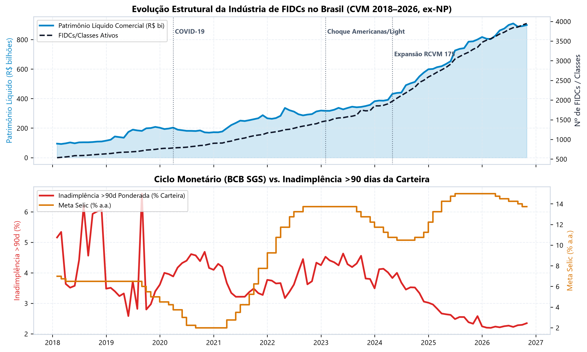

# Fase 1 & 2 — Lakehouse Medallion (CVM + BCB), Reconciliação RCVM 175 e Anti-Vazamento

## 1. Escopo da Ingestão e Harmonização Multi-Geração

O painel longitudinal consolidado abrange **106 competências mensais consecutivas** (`2018-01` a `2026-10`), integrando:
- **CVM `INF_MENSAL_FIDC`**: 7 pacotes anuais históricos (`2018`–`2024`) e 22 pacotes mensais (`202501`–`202610`), somando mais de 1.800 arquivos CSV brutos harmonizados entre três gerações de layout regulatório:
  - *Geração 1 (`2018`–`2019`)*: 15 tabelas por competência, chave `CNPJ_FUNDO` e 9 cedentes (`TAB_I2B1_CPF_CNPJ_CEDENTE_1..9`);
  - *Geração 2 (`2020`)*: 17 tabelas por competência, inclusão do perfil detalhado de cotistas (`tab_X_1_1`), garantias (`tab_X_7`) e expansão para 18 cedentes (`TAB_I2A12` com risco + `TAB_I2B12` sem risco);
  - *Geração 3 (`2021`–`2026`, Marco Regulatório RCVM 175)*: 18 tabelas por competência, migração para `CNPJ_FUNDO_CLASSE` / `CNPJ_CLASSE` e inclusão da **Tabela X de Risco Regulatório SCR (`AA` a `H`, Resolução CMN/BCB nº 2.682)** a partir de outubro de 2023.
- **CVM Cadastro Estrutural Sem Viés de Sobrevivência**: união determinística de `registro_fundo_classe.zip` (classes/subclasses RCVM 175) com `cad_fi.csv` (histórico legado de fundos liquidados ou cancelados antes de 2024), mapeando **Gestor**, **Administrador**, **Custodiante**, **Público-Alvo**, **Taxa de Administração** e datas de constituição/cancelamento.
- **Banco Central do Brasil (`SGS`)**: 11 séries oficiais (CDI acumulado mensal `4391`, Meta Selic `432`, IPCA `433`, IBC-Br `24363`, Inadimplência SFN Total/PJ/PF `21082..21084`, Spread bancário `20783`, Endividamento `29037`, Comprometimento de renda `29034` e Desocupação PNAD `24369`).

---

## 2. Achado Crítico de Engenharia de Dados: Preservação de Zeros à Esquerda em CNPJs

Durante a auditoria automatizada da camada Silver, identificamos uma assimetria silenciosa nos arquivos abertos da CVM:
- A coluna `CNPJ_FUNDO_CLASSE` é publicada formatada (`05.754.060/0001-13`), forçando inferência textual em leitores CSV;
- Já as colunas `CNPJ_Classe`, `CPF_CNPJ_Gestor` e os 18 campos `CPF_CNPJ_CEDENTE_k` são publicados **sem pontuação** (`00360305000104`, `07652226000116`) e contêm células vazias (`NaN`).

Sem tipagem explícita (`dtype=str`) na leitura bruta, inferidores numéricos convertem essas colunas para `float64`:
1. CNPJs iniciados por `0` (mais de um terço das empresas e instituições financeiras brasileiras, como `00360305000104`) perdem os zeros à esquerda e passam a ter 12 ou 13 dígitos;
2. O sufixo decimal `.0` do `float64`, quando submetido à remoção ingênua de não-dígitos, adiciona um `0` espúrio ao final do documento.

A tabela abaixo registra o impacto real auditado em `reports/metrics/silver_quality_audit.json` antes e depois da correção de schema e sanitização documental em `transforms.py`:

| Métrica Auditada na Camada Silver | Sem `dtype=str` (Inferência Numérica) | Com `dtype=str` + Normalização Estrita | Impacto |
|---|---:|---:|---|
| Observações fundo-mês (`2018-01` .. `2026-10`) | 215.842 | **215.748** | Reconciliação exata de `CNPJ_CLASSE` |
| Cobertura de Gestor identificado (`cnpj_gestor`) | 23,83% | **99,87%** | **+76,04 p.p.** (602 gestoras únicas) |
| Arestas válidas `FIDC ↔ Cedente` extraídas | 34.872 | **135.260** | **3,88× mais arestas de crédito** |
| Cedentes corporativos PJ únicos (14 dígitos) | 2.489 | **8.594** | **3,45× mais originadores na rede** |
| Duplicatas de transição RCVM 175 removidas | 1.151 | **1.245** | Eliminação de dupla contagem `Fundo`/`Classe` |
| Invariante contábil $\sum \text{Faixas Aging} = \text{Inad. Total}$ | 99,987% | **99,987%** | Consistência contábil das Tabelas V e VI |
| Reconciliação $\sum \text{PL Tranches} \approx \text{PL Tabela IV}$ | 97,723% | **97,724%** | Classificação correta de `Subordinada Mezanino` |

---

## 3. Governança Anti-Vazamento e Coorte de Alerta Precoce (Gold)

O painel Gold (`215.748` linhas × `103` features causais organizadas em 6 famílias) impõe três barreiras formais contra vazamento de informação:

1. **Invariância por Perturbação Adversarial do Futuro (`tests/test_anti_leakage.py`)**: corrompendo arbitrariamente todas as realizações em $dt > t_0$ (inadimplência, PDD, recompras, retornos e Selic), todas as `103` features em $dt \le t_0$ permanecem idênticas até `1e-12`.
2. **Grafo Leave-One-Out (LOO) Estritamente Contemporâneo**: nas agregações de rede por Cedente compartilhado (`contagion_cedente_*`), Gestor (`gestor_loo_*`) e Administrador (`admin_loo_*`), a própria observação do fundo $i$ é algebricamente subtraída do numerador e do denominador antes do cálculo ponderado. Cedentes exclusivos (grau 1) recebem contágio identicamente nulo.
3. **Embargo Exato de Horizonte ($h$ meses)**: como o rótulo de estresse em $h=6$ meses avalia realizações em $[t+1, \dots, t+6]$, todas as janelas *walk-forward* exigem $\text{ym}(t_{\text{treino}}) + h < \text{ym}(T_{\text{início\_teste}})$ — por exemplo, para testar a partir de `2023-01`, o último ponto de treino permitido é `2022-06` (cujo rótulo se encerra em `2022-12`).

Separando estruturalmente os FIDC-NP (`19,87%` das observações totais, vocacionados a precatórios e créditos já judicializados) e restringindo a largada a fundos comerciais saudáveis em $t$ (`PL >= R$ 5M`, `Carteira >= R$ 2M`, sem estresse ativo em $t$), obtemos **125.308 origens elegíveis** com taxa base de entrada em estresse severo de **7,06% em 3 meses** e **12,54% em 6 meses** (sendo 5,61% choques nominais diretos na cota sênior e 7,76% saltos severos de inadimplência/PDD rompendo o colchão estrutural).
