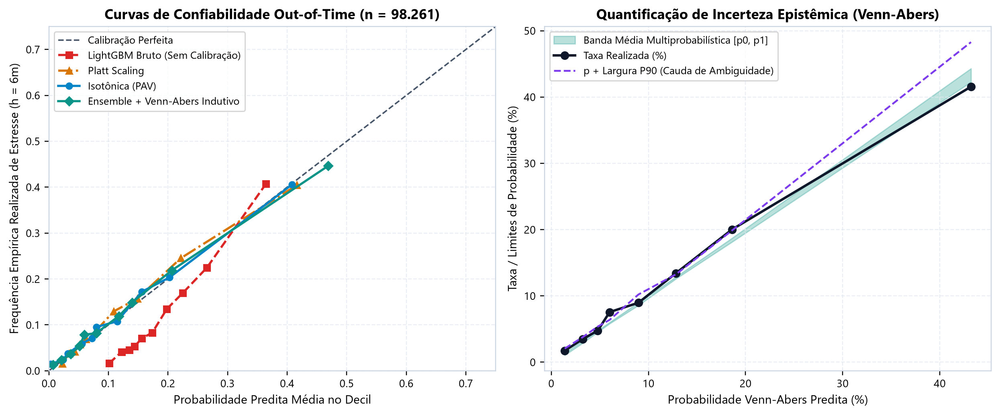
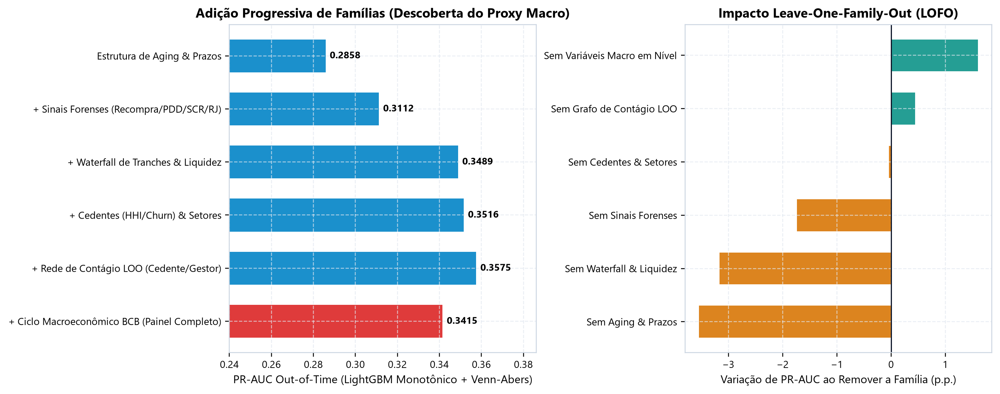

# Fase 3 — Modelos Tabulares, Calibração Venn-Abers e o Achado de Ablação Macroeconômica

## 1. Protocolo Experimental

Avaliamos todos os modelos sobre as **98.261 previsões out-of-time** distribuídas em quatro janelas *expanding-window* (`2022`, `2023`, `2024` e `2025–2026`), respeitando embargo temporal estrito de **6 meses** para $h=6\text{m}$ e **3 meses** para $h=3\text{m}$ tanto entre treino e teste quanto entre ajuste (`fit_mask`) e cauda interna de calibração/early-stopping (`cal_mask`).

---

## 2. Resultados Consolidados Out-of-Time ($n = 98.261$)

### Horizonte Primário: $h = 6$ meses (Taxa Base = 12,47%)

| Modelo | PR-AUC | ROC-AUC | Brier Score | Log-Loss | ECE (10 quantis) | Recall @ Top-5% | Lift @ Top-5% |
|---|---:|---:|---:|---:|---:|---:|---:|
| Comitê Estrutural (Regra Heurística) | 0,2757 | 0,6892 | 0,1026 | 0,3529 | 0,0209 | 16,27% | 3,25× |
| Hazard Logístico Regularizado + VA | 0,3076 | 0,7269 | 0,1021 | 0,3447 | 0,0365 | 18,14% | 3,63× |
| LightGBM Irrestrito (Bruto, Sem Calibração) | 0,3401 | 0,7644 | 0,1014 | 0,3519 | 0,0724 | 19,12% | 3,82× |
| LightGBM + Platt Scaling | 0,3465 | 0,7691 | 0,0953 | 0,3218 | 0,0098 | 19,14% | 3,83× |
| LightGBM + Isotônica (PAV) | 0,3461 | 0,7683 | 0,0951 | 0,3264 | 0,0089 | 19,87% | 3,97× |
| LightGBM Irrestrito + Venn-Abers | 0,3475 | 0,7684 | 0,0950 | 0,3216 | **0,0070** | 19,80% | 3,96× |
| LightGBM Monotônico + Venn-Abers | 0,3412 | 0,7645 | 0,0955 | 0,3239 | 0,0095 | 19,31% | 3,86× |
| **CatBoost Ordenado + Venn-Abers** | **0,3773** | 0,7858 | 0,0930 | 0,3142 | 0,0128 | **21,32%** | **4,26×** |
| **Ensemble GBDT (LGBM + CatBoost) + VA** | 0,3769 | **0,7866** | **0,0928** | **0,3137** | 0,0079 | 21,28% | 4,26× |

### Horizonte Curto: $h = 3$ meses (Taxa Base = 7,10%)

| Modelo | PR-AUC | ROC-AUC | Brier Score | ECE | Recall @ Top-5% | Lift @ Top-5% |
|---|---:|---:|---:|---:|---:|---:|
| Comitê Estrutural (Regra Heurística) | 0,1976 | 0,7135 | 0,0630 | 0,0167 | 20,04% | 4,01× |
| Hazard Logístico Regularizado + VA | 0,2465 | 0,7656 | 0,0611 | 0,0183 | 24,22% | 4,84× |
| LightGBM Irrestrito + Venn-Abers | 0,2639 | 0,7928 | 0,0586 | 0,0054 | 24,91% | 4,98× |
| LightGBM Monotônico + Venn-Abers | 0,2621 | 0,7933 | 0,0586 | 0,0055 | 25,57% | 5,11× |
| **CatBoost Ordenado + Venn-Abers** | **0,3109** | 0,8116 | **0,0567** | 0,0054 | **28,69%** | **5,74×** |
| **Ensemble GBDT + Venn-Abers** | 0,3091 | **0,8131** | **0,0567** | **0,0047** | 28,65% | 5,73× |

**Significância Estatística (Cluster Bootstrap por Entidade, 400 reamostragens)**:
- `Ensemble GBDT + VA` supera a Regra de Comitê Estrutural em **+10,08 p.p.** de PR-AUC (`IC 95%: [+8,54; +11,64 p.p.]`, $p < 0,0001$) e supera o Hazard Logístico em **+6,86 p.p.** (`IC 95%: [+5,65; +8,26 p.p.]`, $p < 0,0001$).
- **Decomposição por Sub-Alvo ($h=6\text{m}$)**: o ganho se mantém tanto em explosões de inadimplência/PDD (`PR-AUC 0,3508` vs `0,2424` da regra) quanto em choques nominais diretos na cota sênior (`PR-AUC 0,1079` vs `0,0905` da regra).

---

## 3. Três Achados Científicos Honestos

### Achado 1 — Venn-Abers Indutivo resolve o dilema entre Isotônica e Platt
Árvores com reponderação de classe (`scale_pos_weight`) produzem escores brutos severamente descalibrados (`ECE = 7,24%`). A Regressão Isotônica reduz o `ECE` para `0,89%`, mas penaliza a `Log-Loss` (`0,3264` vs `0,3218` de Platt) por gerar degraus degenerados nas extremidades. O **Venn-Abers Indutivo** regulariza as duas regressões isotônicas concorrentes ($Y=0$ e $Y=1$), alcançando simultaneamente **o menor ECE (`0,70%`, queda de 10×), o menor Brier (`0,0950`) e a menor Log-Loss (`0,3216`)**, além de fornecer intervalos epistêmicos $[p_0(x), p_1(x)]$ válidos em amostra finita.

### Achado 2 — O que NÃO funcionou: Variáveis Macroeconômicas em Nível prejudicam Árvores Out-of-Time
Na ablação sistemática das 6 famílias de features (`reports/metrics/tabular_ablation_h6.csv`), todas as cinco famílias microeconômicas e de rede geram ganhos cumulativos consistentes:
1. `Estrutura de Aging & Prazos` (23 features): `PR-AUC = 0,2858`
2. `+ Sinais Forenses (Recompra, PDD, SCR, RJ)` (38 features): `PR-AUC = 0,3112` (**+2,54 p.p.**)
3. `+ Waterfall de Tranches & Liquidez` (60 features): `PR-AUC = 0,3489` (**+3,77 p.p.**, `ROC-AUC` salta de `0,695` para `0,771`!)
4. `+ Cedentes (HHI/Churn) & Setores` (82 features): `PR-AUC = 0,3516` (**+0,27 p.p.**)
5. `+ Rede de Contágio LOO (Cedentes/Gestor)` (92 features): **`PR-AUC = 0,3575`** (**+0,59 p.p.**, pico!)
6. `+ Ciclo Macroeconômico BCB em Nível` (103 features): **`PR-AUC` cai para `0,3415` (`-1,60 p.p.`)**!

**Por que isso ocorre?** Como séries macroeconômicas agregadas (`Selic`, `IBC-Br`, `Inadimplência SFN`) são constantes em todo o corte transversal de um mesmo mês, árvores de decisão usam cortes como `Selic > 6,5%` como **proxies espúrios de data calendário**, memorizando a taxa base de períodos passados que não se repete quando o regime monetário muda fora da amostra. Na validação *Leave-One-Family-Out*, remover apenas `macro_cycle` restaura imediatamente o `PR-AUC` para `0,3575`.

### Achado 3 — Restrições Monotônicas têm trade-off dependente do horizonte
Em $h=3\text{m}$, impor monotonicidade estrutural (`lgbm_monotonic_va`) melhora o `Recall@Top-5%` (`25,57%` vs `24,91%`) e a `Log-Loss`. Porém, em $h=6\text{m}$, reduz o `PR-AUC` global em `-0,63 p.p.` (`0,3412` vs `0,3475`). A razão econômica é real: fundos cativos de crédito pessoal *subprime* frequentemente operam com subordinação aparente muito elevada (>50%) justamente porque o originador retém toda a cota júnior para cobrir perdas estruturais extremas — criando uma não-monotonicidade genuína na cauda direita de `subordinacao_pct`.
