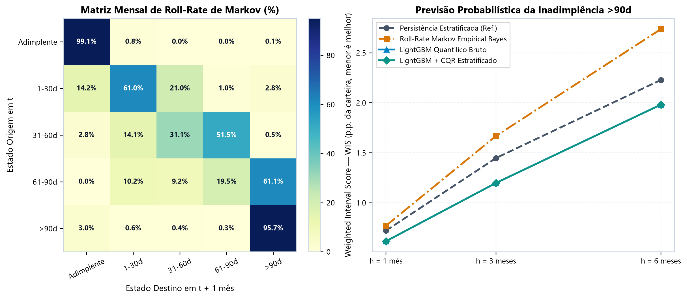

# Fase 4 — Matrizes de Roll-Rate de Markov (Empirical Bayes) e Previsão Quantílica Conformal (CQR)

## 1. Formulação: Dinâmica Contínua da Inadimplência $>90$ Dias

Além de prever o evento discreto de entrada em estresse severo (Tarefa 1), gestores de risco e estruturadores precisam projetar a **distribuição futura completa da taxa de inadimplência $>90$ dias** ($\text{Inad}_{>90\text{d}, t+h} \in [0, 1]$) nos horizontes $h \in \{1, 3, 6\}$ meses sobre todos os quantis operacionais $\alpha \in \{0.05, 0.10, 0.25, 0.50, 0.75, 0.90, 0.95\}$.

Comparamos cinco abordagens sobre todos os FIDCs comerciais ativos (`Carteira >= R$ 2M`, ex-NP), mantendo o mesmo protocolo *walk-forward* com embargo igual a $h$ meses:

1. **Persistência Global**: mediana $\hat{q}_{0.50} = \text{Inad}_{>90\text{d}, t}$ com quantis empíricos globais na cauda de calibração;
2. **Persistência Estratificada por Patamar de Atraso (Referência Forte)**: quantis de resíduo estimados separadamente em 4 estratos heterocedásticos (`0%`, `(0%, 2%]`, `(2%, 8%]`, `>8%`);
3. **Matriz de Roll-Rate de Markov 5×5 c/ Empirical Bayes Setorial**: estima a transição mensal no simplex `Adimplente → 1–30d → 31–60d → 61–90d → >90d` via mínimos quadrados não-negativos (`NNLS`), combinando a matriz setorial com a global ($\kappa = 1500$) e iterando $\hat{s}_{t+h} = s_t (\hat{M}_{\text{setor}})^h$;
4. **LightGBM Quantílico Global Bruto**: 7 modelos *pinball-loss* independentes com imposição pós-ajuste de não-cruzamento;
5. **LightGBM + Conformalized Quantile Regression (CQR Estratificado)**: calibração de Romano, Patterson & Candès (2019) por estrato inicial de inadimplência preservando a mediana $\hat{q}_{0.50}$.

---

## 2. Matriz Mensal Estimada de Roll-Rate da Indústria

A matriz global linha-estocástica estimada por `NNLS` (`reports/metrics/markov_global_transition_matrix.csv`) revela a física real do envelhecimento de recebíveis nos FIDCs brasileiros:

| Estado em $t$ \ Destino em $t+1$ | Adimplente | 1–30 dias | 31–60 dias | 61–90 dias | >90 dias |
|---|---:|---:|---:|---:|---:|
| **Adimplente** | **99,06%** | 0,82% | 0,00% | 0,00% | 0,11% |
| **Vencido 1–30 dias** | 14,19% *(cura/recompra)* | **61,04%** | **20,97%** *(rolagem)* | 0,97% | 2,83% |
| **Vencido 31–60 dias** | 2,81% | 14,11% | 31,05% | **51,48%** *(rolagem)* | 0,54% |
| **Vencido 61–90 dias** | 0,00% | 10,20% | 9,21% | 19,45% | **61,13%** *(entrada em default)* |
| **Vencido >90 dias** | 2,99% *(baixa/recompra)* | 0,63% | 0,37% | 0,27% | **95,73%** *(estado absorvente)* |

Observe a progressão mecânica da deterioração: enquanto `14,2%` do atraso inicial (`1–30d`) retorna à adimplência ou é recomprado no mês seguinte, **51,5% da faixa `31–60d` rola para `61–90d`**, **61,1% da faixa `61–90d` cruza para `>90d`**, e uma vez acima de 90 dias o crédito torna-se quase absorvente (`95,7%` de persistência mensal).

---

## 3. Resultados Comparativos Out-of-Time

Valores de **WIS** (*Weighted Interval Score*), **MAE** e largura do intervalo de 90% expressos em **pontos percentuais (p.p.) da carteira**:

| Horizonte | Modelo | $N_{\text{obs}}$ | WIS (p.p.) | MAE (p.p.) | Cobertura 80% | Cobertura 90% | Largura 90% (p.p.) |
|---|---|---:|---:|---:|---:|---:|---:|
| **$h = 1\text{m}$** | Persistência Global | 119.615 | 0,813 | 0,863 | 82,3% | 90,9% | 2,25 |
| | Persistência Estratificada (Ref.) | 119.615 | 0,722 | 0,863 | 88,4% | 92,3% | 2,86 |
| | Roll-Rate Markov Empirical Bayes | 119.615 | 0,771 | 1,096 | 87,6% | 91,9% | 2,90 |
| | LightGBM Quantílico Bruto | 119.615 | 0,616 | 0,857 | 91,7% | 95,7% | 4,48 |
| | **LightGBM + CQR Estratificado** | 119.615 | **0,616** (**-14,7%**) | **0,857** | 91,6% | 95,8% | 4,51 |
| **$h = 3\text{m}$** | Persistência Global | 111.051 | 1,676 | 1,825 | 82,0% | 90,7% | 6,27 |
| | Persistência Estratificada (Ref.) | 111.051 | 1,447 | 1,825 | 85,8% | 92,5% | 5,92 |
| | Roll-Rate Markov Empirical Bayes | 111.051 | 1,668 | 2,688 | 86,0% | 91,0% | 6,49 |
| | LightGBM Quantílico Bruto | 111.051 | 1,199 | 1,730 | 89,4% | 94,3% | 9,46 |
| | **LightGBM + CQR Estratificado** | 111.051 | **1,198** (**-17,2%**) | **1,730** | 89,7% | 94,9% | 9,53 |
| **$h = 6\text{m}$** | Persistência Global | 98.764 | 2,597 | 2,891 | 81,7% | 90,5% | 11,74 |
| | Persistência Estratificada (Ref.) | 98.764 | 2,229 | 2,891 | 85,8% | 92,1% | 9,56 |
| | Roll-Rate Markov Empirical Bayes | 98.764 | 2,737 | 4,920 | 85,3% | 90,1% | 11,16 |
| | LightGBM Quantílico Bruto | 98.764 | 1,982 | 2,813 | 87,9% | 93,6% | 15,84 |
| | **LightGBM + CQR Estratificado** | 98.764 | **1,981** (**-11,1%**) | **2,813** | **88,8%** | **94,3%** | 15,88 |

---

## 4. Análise Crítica: Por que a Matriz de Markov Pura Deriva em Horizontes Longos?

1. **Limitação Estrutural da Cadeia Homogênea $s_t M^h$**: embora a matriz 5×5 capture com precisão a rolagem física de curto prazo, iterar $s_t M^6$ assume transição estacionária fechada. Em FIDCs abertos/rotativos, o denominador da carteira é renovado mensalmente por novas aquisições (`vl_aquisicoes_mes`) e o estoque vencido sofre intervenção heterogênea de coobrigação/recompra (`vl_recompras_mes`). Sem condicionar nessas variáveis, a potência matricial superestima o acúmulo secular no estado absorvente `>90d` (`MAE = 4,92 p.p.` em $h=6\text{m}$ vs `2,81 p.p.` do LightGBM).
2. **Papel do CQR Estratificado**: o LightGBM quantílico reduz o `WIS` em **14,7% ($h=1\text{m}$), 17,2% ($h=3\text{m}$) e 11,1% ($h=6\text{m}$)** contra a persistência estratificada. O ajuste conformal CQR preserva o ganho de WIS e corrige sub-cobertura residual na faixa de 80% em $h=6\text{m}$ (`87,9% → 88,8%`) e na cauda de fundos já com atraso inicial elevado.
