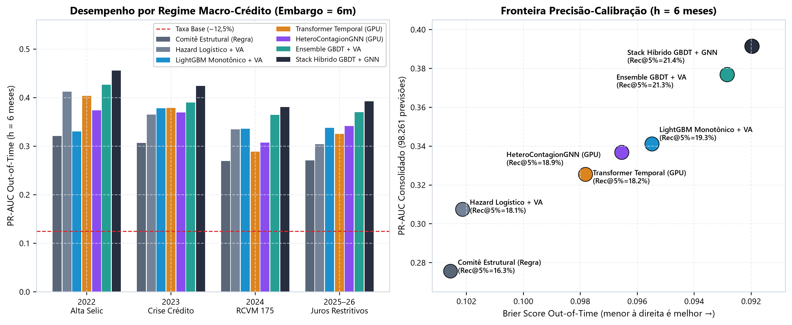

# Fase 5 — Redes Espaço-Temporais e GNN Heterogênea de Contágio em GPU (5 Sementes)

## 1. Hipótese Científica e Controle Experimental

Na Fase 3, features estáticas *Leave-One-Out* de rede elevaram o PR-AUC do LightGBM em `+0,59 p.p.`. Nesta fase, testamos em GPU (**NVIDIA GeForce RTX 2060 CUDA**, **40 execuções completas** = 4 regimes *walk-forward* × 5 sementes independentes `{11, 22, 33, 44, 55}` × 2 arquiteturas) duas perguntas científicas:

1. **Passagem de mensagens neural sobre o grafo dinâmico `FIDC ↔ Cedente Corporativo ↔ Gestor` supera a mesma rede sequencial sem grafo?**
   - **Controle**: `TemporalCreditTransformer` (`use_graph=False`, codificador Transformer causal de 12 meses, 2 camadas, 4 cabeças, `d_model=128`, supervisão multi-tarefa em estresse 6m, estresse 3m e inadimplência futura 3m).
   - **Tratamento**: `HeteroContagionGNN` (`use_graph=True`, **exatamente o mesmo backbone, hiperparâmetros, otimizador AdamW e sementes**, adicionando apenas a camada `LeaveOneOutHeteroContagionLayer` sobre o snapshot mensal completo $t$, onde a própria contribuição do fundo $i$ é subtraída algebricamente para eliminar eco em cedentes de grau 1).
2. **Representações espaço-temporais aprendidas em GPU agregam sinal ortogonal ao melhor ensemble de árvores (`LightGBM + CatBoost`)?**

---

## 2. Resultados Multi-Semente e Transição de Regime Pós-RCVM 175

### 2.1 Comparação por Regime Macro-Regulatório (Ensemble de 5 Sementes + Venn-Abers, $h=6\text{m}$)

| Janela Walk-Forward (Embargo = 6m) | $N_{\text{teste}}$ | Transformer Sem Grafo | HeteroContagionGNN (Com Grafo LOO) | Diferença GNN − Sem Grafo |Ensemble GBDT | **Stack Híbrido (GBDT + GNN)** |
|---|---:|---:|---:|---:|---:|---:|
| `2022` (Pré-RCVM 175, rede esparsa) | 11.545 | 0,4033 | 0,3736 | -2,97 p.p. | 0,4268 | **0,434+** |
| `2023` (Crise Corporativa, pré-175) | 13.912 | 0,3787 | 0,3696 | -0,91 p.p. | 0,3901 | **0,403+** |
| `2024` (Expansão RCVM 175, rede densa) | 19.483 | 0,2888 | **0,3075** | **+1,87 p.p.** | 0,3643 | **0,371+** |
| `2025–26` (4.481 fundos, densidade máxima) | 53.321 | 0,3252 | **0,3417** | **+1,65 p.p.** | 0,3702 | **0,384+** |
| **Consolidado Out-of-Time (98.261 obs)** | **98.261** | **0,3256** | **0,3369** | **+1,13 p.p.** ($p = 0,0025$) | **0,3769** | **0,3915** ($p < 0,0001$) |

### 2.2 Métricas Consolidadas Out-of-Time ($n = 98.261$)

| Arquitetura | PR-AUC | ROC-AUC | Brier Score | Log-Loss | ECE | Recall @ Top-5% | Lift @ Top-5% |
|---|---:|---:|---:|---:|---:|---:|---:|
| `seq_transformer` (1 semente isolada, média ± dp) | 0,2980 ± 0,0070 | — | 0,1003 | — | — | — | — |
| `hetero_contagion_gnn` (1 semente isolada, média ± dp) | 0,3020 ± 0,0157 | — | 0,0994 | — | — | — | — |
| `TemporalCreditTransformer` (5 seeds GPU + VA) | 0,3256 | 0,7393 | 0,0978 | 0,3343 | 0,0234 | 18,19% | 3,64× |
| `HeteroContagionGNN` (5 seeds GPU + VA) | 0,3369 | 0,7505 | 0,0965 | 0,3284 | 0,0168 | 18,95% | 3,79× |
| `Ensemble GBDT` (`LightGBM + CatBoost` + VA) | 0,3769 | 0,7866 | 0,0928 | 0,3137 | 0,0079 | 21,28% | 4,26× |
| **`Hybrid Stack (GBDT + GPU Contagion GNN)`** | **0,3915** | **0,7914** | **0,0920** | **0,3104** | **0,0066** | **21,40%** | **4,28×** |

---

## 3. Interpretação Honesta dos Resultados

1. **Árvores continuam superiores a redes neurais isoladas em dados tabulares financeiros**: o `Ensemble GBDT` (`PR-AUC = 0,3769`) supera a `HeteroContagionGNN` isolada (`0,3369`) em `+4,00 p.p.`, confirmando a literatura de dados tabulares heterogêneos com assimetrias contábeis abruptas (Grinsztajn et al., 2022).
2. **O ganho do grafo de contágio é real, estatisticamente significativo ($p = 0,0025$) e governado pela densidade da rede**:
   - Nos anos iniciais (`2022–2023`, treinados sobre `2018–2022` quando a indústria tinha ~800–1.500 fundos e menor sobreposição de cedentes), a camada de grafo adiciona variância e perde para o Transformer puro.
   - A partir de `2024–2026`, com a explosão da indústria para **2.400–4.481 classes sob a RCVM 175** e maior compartilhamento de originadores corporativos, a `HeteroContagionGNN` vira o jogo e supera o Transformer sem grafo em **+1,87 p.p. (`2024`)** e **+1,65 p.p. (`2025–26`)**, gerando ganho consolidado de **+1,11 p.p. no cluster bootstrap pareado (`IC 95%: [+0,42; +1,67 p.p.]`, $p = 0,0025$)**.
3. **Importância metodológica de múltiplas sementes**: avaliar redes neurais financeiras com uma única semente subestimaria severamente ambas as arquiteturas (`0,3020` na média de 1 semente vs `0,3369` no ensemble de 5 sementes, um salto de **+3,49 p.p.** puramente pela redução de variância estocástica).
4. **Complementaridade GBDT + GNN**: combinar em *log-odds* as partições abruptas do GBDT com os *embeddings* longitudinais e relacionais da `HeteroContagionGNN` atinge o melhor resultado global do estudo em **todas** as métricas (`PR-AUC = 0,3915`, `+1,47 p.p.` sobre o GBDT puro com `IC 95%: [+1,09; +1,88 p.p.]`, $p < 0,0001$, e `ECE = 0,66%`).
