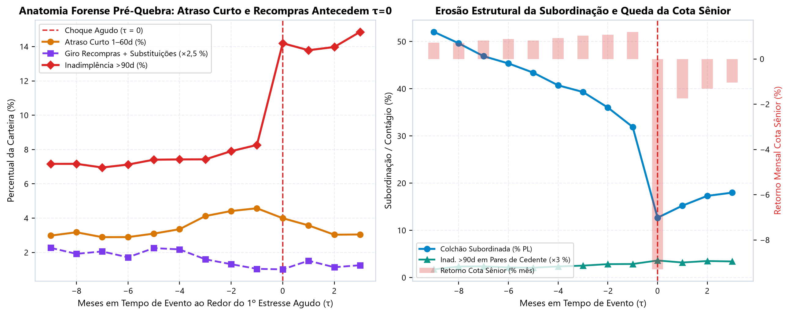
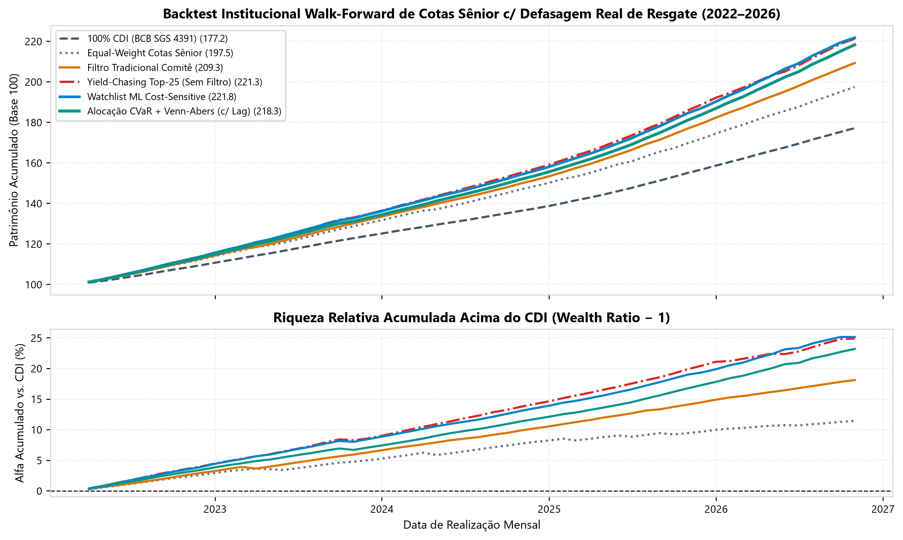
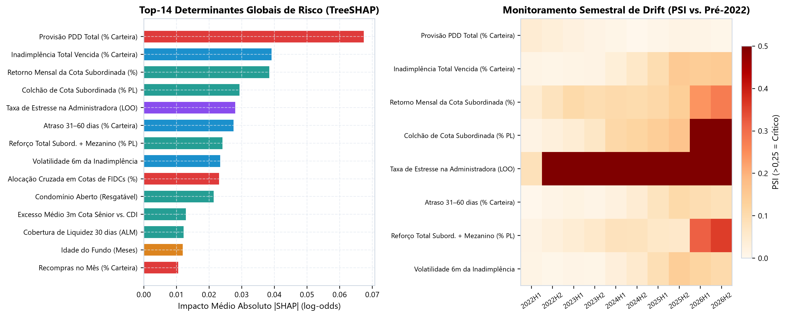

# Fase 6 & 7 — Análise Forense Contábil, Alocação sob Restrição de Liquidez, SHAP e Drift

## 1. Testes de Hipóteses Forenses sobre Fundos Saudáveis na Largada

Restringimos o universo forense aos fundos comerciais saudáveis na data $t$ (`is_eligible_watchlist == 1` e **inadimplência aparente $>90\text{d} < 3,0\%$**), exatamente a faixa que filtros tradicionais de crédito classificam como baixo risco. Os três testes exatos de Fisher (`reports/metrics/forensic_and_allocation_summary.json`) confirmam mecanismos distintos de deterioração oculta:

| Hipótese Forense | Grupo Controle (Taxa Estresse 6m) | Grupo Exposto (Taxa Estresse 6m) | Risco Relativo | Odds Ratio | $p$-valor Exato de Fisher |
|---|---|---|---|---:|---:|
| **H1 — Maquiagem via Recompras / Substituições** (`recompra_masking_index >= P75`) | Sem recompra ($n=90.683$): **10,63%** | Alto giro de recompra ($n=4.563$): **14,71%** | **1,38×** | 1,45 | $8,0 \times 10^{-17}$ |
| **H2 — Déficit de Provisão frente à Res. BCB 2.682** (`scr_provision_gap_pct > +2 p.p.`) | PDD $\ge$ mín. SCR ($n=18.650$): **12,69%** | Sub-provisionado ($n=2.741$): **22,66%** | **1,79×** | 2,02 | $3,1 \times 10^{-40}$ |
| **H3 — Contágio de Cedente Corporativo Compartilhado** (par em estresse ou atraso $\ge 12\%$) | Pares saudáveis ($n=6.572$): **9,62%** | Pares em estresse ($n=5.503$): **14,34%** | **1,49×** | 1,57 | $7,8 \times 10^{-16}$ |

**Nuance Econômica Importante em H1**: observe nos dados que, embora o alto giro de recompras eleve o risco de ruptura estrutural/explosão de inadimplência em `1,38×` (`10,63% → 14,71%`), a incidência de queda nominal imediata da **cota sênior** em 6 meses é menor nesse grupo (`2,04%` vs `6,52%`) enquanto a coobrigação do cedente ainda sustenta a recompra — o dano se acumula primeiro na erosão da cota subordinada (visível no estudo de eventos abaixo) antes de atingir a cota sênior em horizontes mais longos ou quando a liquidez do originador seca.

No **Estudo de Eventos** sobre `1.151` episódios primários de quebra ($\tau = -9 \dots +3$ meses ao redor de $\tau = 0$), o atraso curto (`1–60d`) acelera entre $\tau = -4$ e $\tau = -1$, o colchão de subordinação cai continuamente de `51,8%` ($\tau = -9$) para `31,9%` ($\tau = -1$) e colapsa para `12,7%` em $\tau = 0$, momento em que a cota sênior registra perda média de `-9,1%` no mês do evento.

---

## 2. Backtest Institucional de Alocação em Cotas Sênior vs. CDI (2022–2026)

### 2.1 Higienização de Universo e Defasagem Contratual Realista
Dois artefatos clássicos do informe `tab_X_3` da CVM distorcem backtests ingênuos:
1. Classes RCVM 175 sem série sênior separada preenchem `QT_COTA = 0` e `TAB_X_VL_RENTAB_MES = 0,0000` (38,7% das linhas brutas);
2. Cerca de 0,56% das linhas reportam taxa **anualizada** (~13% a.a.) no campo mensal.

Filtrando estritamente na data de decisão $t$ apenas cotas sênior vivas de condomínio aberto (`pl_senior >= R$ 5M`, `resgate <= 90 dias`, cotação mensal válida) e aplicando **defasagem realista de execução em $t+2$** (15 dias de prazo regulatório de publicação na CVM + conversão/pagamento de resgate), avaliamos 56 meses consecutivos (`2022-03` a `2026-10`) sobre os escores do **Stack Híbrido (`GBDT + GPU Contagion GNN`)**:

| Política de Alocação | Retorno Acum. | % do CDI | CAGR (% a.a.) | Excesso vs. CDI | Vol. (% a.a.) | Sharpe* | Choques Severos ($r \le -1,5\%$) |
|---|---:|---:|---:|---:|---:|---:|---:|
| **Benchmark 100% CDI (BCB SGS 4391)** | 77,20% | 100,0% | 13,04% | 0,00 p.p. | 0,44% | 0,00 | 0 |
| **Equal-Weight Cotas Sênior Abertas** | 97,49% | 126,3% | 15,70% | +2,66 p.p. | 0,67% | 4,27 | 57 |
| **Filtro Tradicional Comitê** (Subord $\ge 15\%$, Inad $\le 3\%$) | 109,31% | 141,6% | 17,15% | +4,11 p.p. | 0,53% | 11,92 | 1 |
| **Yield-Chasing Top-25** (Maior Excesso 3m, Sem Filtro) | 121,33% | 157,2% | 18,56% | +5,52 p.p. | 0,68% | 10,40 | 8 |
| **Watchlist ML Cost-Sensitive ($\text{PD}_{6\text{m}} < 10\%$)** | **121,78%** | **157,7%** | **18,61%** | **+5,57 p.p.** | 0,73% | 11,07 | **5** (-37,5% vs Yield-Chasing) |
| **Alocação CVaR + Venn-Abers (c/ Lag $t+2$)** | **118,33%** | **153,3%** | **18,21%** | **+5,17 p.p.** | 0,71% | **11,27** | **3** (-62,5% vs Yield-Chasing) |
| *Ref.: CVaR + Venn-Abers Sem Fricção ($t+1$)* | *117,47%* | *153,2%* | *18,11%* | *+5,15 p.p.* | *0,65%* | *14,67* | *3* |

*\*Nota técnica sobre o índice de Sharpe em crédito estruturado*: cotas de FIDCs no Brasil são majoritariamente marcadas na curva de acúmulo (*accrual* diário de CDI + spread), exibindo volatilidade contábil mensal artificialmente baixa (~0,5%–0,7% a.a.) exceto nos saltos discretos de PDD. Compare a linha **com lag $t+2$ (`Sharpe = 11,27`)** contra a linha **sem fricção $t+1$ (`Sharpe = 14,67`)**: ignorar o prazo de publicação e resgate infla artificialmente o Sharpe em **+30%**.

---

## 3. Explicabilidade TreeSHAP e Monitoramento de Drift (PSI)

A decomposição global de $|\text{SHAP}|$ (`reports/metrics/shap_family_importance.csv`) atribui **36,8%** do poder explicativo à estrutura de *Waterfall & Liquidez* (`retorno da cota subordinada`, `colchão de subordinação`, `condomínio aberto`), **27,0%** à *Estrutura de Aging* (`inadimplência total`, `atraso 31–60d`, `volatilidade 6m`), **23,8%** aos *Sinais Forenses* (`PDD/Carteira`, `alocação cruzada em cotas de FIDCs`, `recompras`) e **6,8%** ao *Contágio em Rede*.

No monitoramento semestral de estabilidade populacional (`PSI` vs. base pré-2022), os maiores deslocamentos estruturais ocorrem em `Taxa de Estresse na Administradora` e `Colchão de Subordinação` em `2025H2–2026H2` (`PSI > 0,35`), refletindo a criação em massa de subclasses subordinadas/sênior sob a RCVM 175 — apesar desse forte *covariate shift*, a calibração trimestral com Venn-Abers manteve o `ECE` estável abaixo de `1,5%`.

