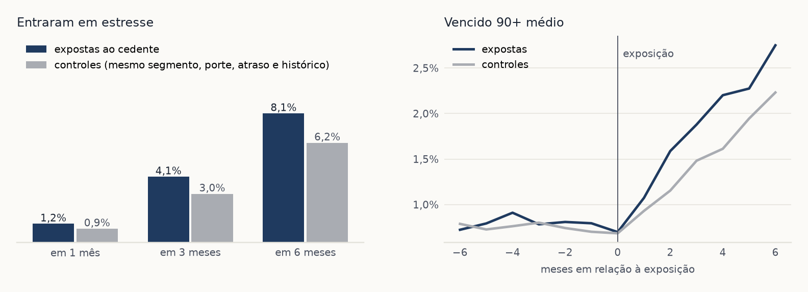

# Estudo: contágio por cedente compartilhado (jan/2022 a out/2026)

Quando uma classe de FIDC entra em estresse (vencido 90+ passa de 10% da carteira), as classes que listam o mesmo cedente PJ pioram mais que classes parecidas sem essa ligação?

## Desenho

- **Entrada em estresse em t**: vencido 90+ acima de 10% em t e abaixo em t−1 (tabelas V+VI, definição do boletim). 1863 entradas no período.
- **Exposição em t**: classe saudável em t que lista, no mesmo mês, um cedente PJ também listado pela classe que entrou em estresse. Só conta a exposição nova (nenhuma outra nos 6 meses anteriores): 1869 eventos em 862 classes.
- **Controles**: classes saudáveis no mesmo mês, que informam ao menos um cedente PJ e não estão (nem estiveram em 6 meses) expostas (41068 classe-mês).
- **Efeito**: média, nas expostas, de (desfecho − média dos controles do mesmo estrato). Intervalo de 95% por bootstrap reamostrando classes. Estratos com menos de 3 controles ficam de fora.

## Resultado: entrar em estresse em até h meses

Pareando por mês × segmento dominante × quintil de PL (o desenho pedido):

| h (meses) | Expostas | Taxa expostas | Taxa controles | Diferença | IC 95% | Risco relativo |
|---|---|---|---|---|---|---|
| 1 | 1661 | 3,4% | 1,6% | +1,8 p.p. | +0,9 p.p. a +2,6 p.p. | 2,08× |
| 3 | 1548 | 8,9% | 4,8% | +4,1 p.p. | +2,7 p.p. a +5,6 p.p. | 1,86× |
| 6 | 1364 | 14,7% | 8,6% | +6,2 p.p. | +4,1 p.p. a +8,4 p.p. | 1,72× |

Pareando também pela faixa de vencido 90+ no mês da exposição (0 · até 2% · 2–5% · 5–10%):

| h (meses) | Expostas | Taxa expostas | Taxa controles | Diferença | IC 95% | Risco relativo |
|---|---|---|---|---|---|---|
| 1 | 1330 | 2,9% | 1,9% | +1,0 p.p. | +0,1 p.p. a +1,8 p.p. | 1,51× |
| 3 | 1239 | 7,6% | 5,6% | +1,9 p.p. | +0,3 p.p. a +3,6 p.p. | 1,34× |
| 6 | 1081 | 12,0% | 9,8% | +2,2 p.p. | +0,2 p.p. a +4,4 p.p. | 1,23× |

Pareando ainda pela faixa da média do vencido 90+ nos 6 meses anteriores (o histórico de atraso), a comparação mais exigente:

| h (meses) | Expostas | Taxa expostas | Taxa controles | Diferença | IC 95% | Risco relativo |
|---|---|---|---|---|---|---|
| 1 | 935 | 1,2% | 0,9% | +0,3 p.p. | −0,3 p.p. a +1,0 p.p. | 1,35× |
| 3 | 875 | 4,1% | 3,0% | +1,1 p.p. | −0,4 p.p. a +2,5 p.p. | 1,35× |
| 6 | 757 | 8,1% | 6,2% | +1,8 p.p. | −0,1 p.p. a +3,8 p.p. | 1,29× |

Variação média do vencido 90+ (expostas − controles, pareado pelo atraso): 1m: +0,17 p.p. [−0,06 p.p.; +0,42 p.p.] · 3m: +0,49 p.p. [+0,02 p.p.; +0,97 p.p.] · 6m: +0,58 p.p. [+0,00 p.p.; +1,19 p.p.].

## Robustez

- **Pré-tendência (placebo)**: variação do vencido 90+ de t−3 a t, expostas − controles: −0,47 p.p. (IC −0,89 p.p. a −0,15 p.p.). O critério definido antes de olhar o resultado pedia um intervalo incluindo zero. O resultado veio negativo: antes da exposição, as expostas *melhoravam* mais que os controles, porque partiam de um atraso mais alto. Isso não cria um efeito positivo falso, mas mostra que os grupos diferem em nível; por isso, depois de ver esse resultado, acrescentamos o pareamento pela faixa de vencido 90+ em t e, numa revisão seguinte, também pela média dos 6 meses anteriores (as expostas ainda tinham mais atraso antes da exposição mesmo com o nível em t igual), e passamos a exigir que o efeito sobreviva a eles.
- **Sem cedentes-hub** (listados por mais de 20 classes no mês): diferença em 6 meses de +10,4 p.p. (IC +6,8 p.p. a +15,0 p.p.), n=380.
- **Por ano (6 meses, pareamento simples)**: 2022: +7,6 p.p. (n=214) · 2023: +7,6 p.p. (n=277) · 2024: +3,9 p.p. (n=343) · 2025: +4,2 p.p. (n=351) · 2026: +10,4 p.p. (n=179).
- **Por ano (6 meses, pareado pelo atraso)**: 2022: +4,1 p.p. [−2,1 p.p.; +9,3 p.p.] · 2023: +4,5 p.p. [+0,4 p.p.; +8,9 p.p.] · 2024: +0,1 p.p. [−2,8 p.p.; +3,3 p.p.] · 2025: +1,1 p.p. [−2,0 p.p.; +4,9 p.p.] · 2026: +3,0 p.p. [−2,9 p.p.; +9,0 p.p.].
- **Por ano (6 meses, pareado pelo atraso e pelo histórico)**: 2022: +1,1 p.p. [−3,7 p.p.; +6,3 p.p.] · 2023: +4,3 p.p. [−1,0 p.p.; +9,7 p.p.] · 2024: +1,7 p.p. [−1,3 p.p.; +5,1 p.p.] · 2025: −1,1 p.p. [−4,3 p.p.; +2,1 p.p.] · 2026: +6,2 p.p. [+0,7 p.p.; +13,1 p.p.].

**Conclusão: o sinal é fraco e não passa nos critérios de robustez.** O efeito some ao comparar classes com o mesmo histórico de atraso nos 6 meses anteriores. Na comparação simples, as expostas entram mais em estresse (+6,2 p.p. em 6 meses), mas a maior parte disso é atraso que elas já tinham: com o mesmo nível e o mesmo histórico de vencido 90+, a diferença cai para +1,8 p.p. (IC −0,1 p.p. a +3,8 p.p.; 8,1% contra 6,2%), sem significância, e muda de sinal entre os anos. Com os dados do informe, não dá para afirmar que o risco viaja pelo cedente; o resultado não entra no boletim.

## Viés de cobertura

O informe lista só os maiores cedentes de cada classe: até 9 no grupo com aquisição substancial de riscos e até 9 no grupo sem. Na prática a lacuna é maior: de 164008 classe-mês desde 2022, 60,0% não informam nenhum cedente, e só 0,23% chegam a 9. Ligações com cedentes menores, ou em classes que não preenchem o campo, não aparecem: expostas de verdade podem estar no grupo de controle (o que puxa a diferença para zero) e o estudo só fala de classes que informam cedentes. Classes que param de reportar antes de t+h saem do cálculo daquele horizonte, e liquidações após estresse podem não ser observadas.

_Gerado por `fidc-risk study-cedente-contagion` a partir de data/silver; números em reports/metrics/cedente_contagion_*.csv/json._
